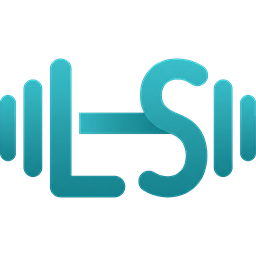

# LibreSteel

A workout planner and tracker that lives entirely on your phone. No account, no server, no internet.

- **1,269 exercises** to search and filter by muscle, equipment and difficulty.
- **Routines you build** — days, sets, target reps, rest, supersets.
- **Live workout** — one exercise at a time, prefilled targets, rest timer, estimated 1RM.
- **Progress** — weekly volume and time, muscle breakdown, best lifts, calendar log.
- **Body stats and calories** — BMI, lean mass, daily target.
- **One CSV file** backs up everything and restores it on a new phone.

Weights work in kg or lb, the app speaks English, French and Arabic, and nothing leaves the device.

## Credit

Exercise names, descriptions and images belong to [JEFIT](https://www.jefit.com) and are mirrored here for personal training. LibreSteel is not affiliated with JEFIT.

## Building it

```sh
dx serve --no-default-features --features desktop   # desktop
dx build --android                                  # phone APK
```
