# LibreSteel

A workout planner and tracker that lives entirely on your phone. No account, no server, no internet.

**[Download LibreSteel 0.1.0 (APK)](https://github.com/O-ELMA/libresteel/releases/download/0.1.0/LibreSteel.apk)** for Android. The phone will warn you because it is installed by hand, not from a store. Allow installs from your browser when it asks.

- **1,269 exercises** to search and filter by muscle, equipment and difficulty.
- **Routines you build**: days, sets, target reps, rest, supersets.
- **Live workout**: one exercise at a time, prefilled targets, rest timer, estimated 1RM.
- **Progress**: weekly volume and time, muscle breakdown, best lifts, calendar log.
- **Body stats and calories**: BMI, lean mass, daily target.
- **One CSV file** backs up everything and restores it on a new phone.

Weights work in kg or lb, the app speaks English, French and Arabic, and nothing leaves the device.

## Screenshots

### Plan a day, then start it

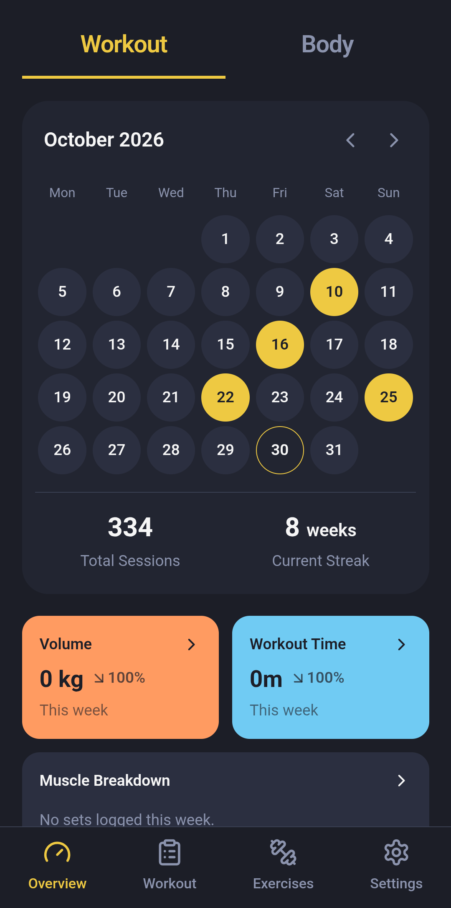 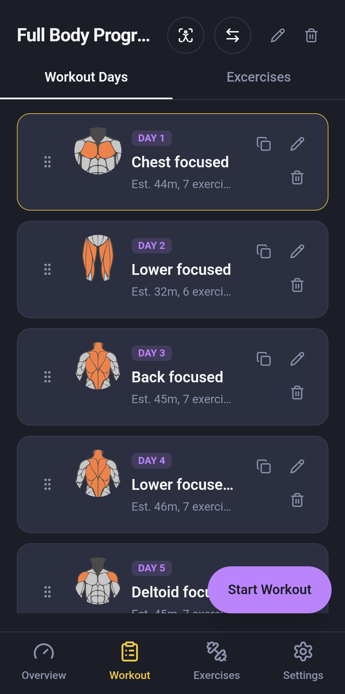

### Find an exercise: browse, filter, read how to do it

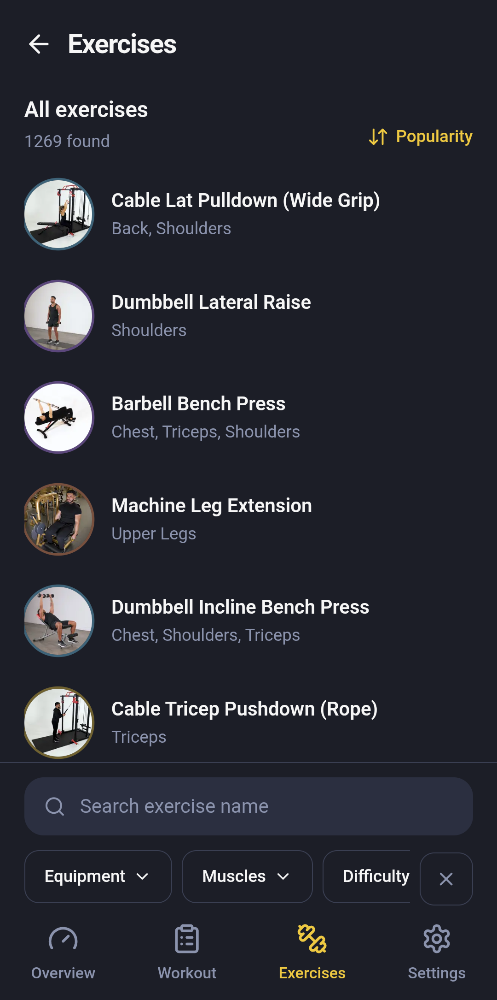 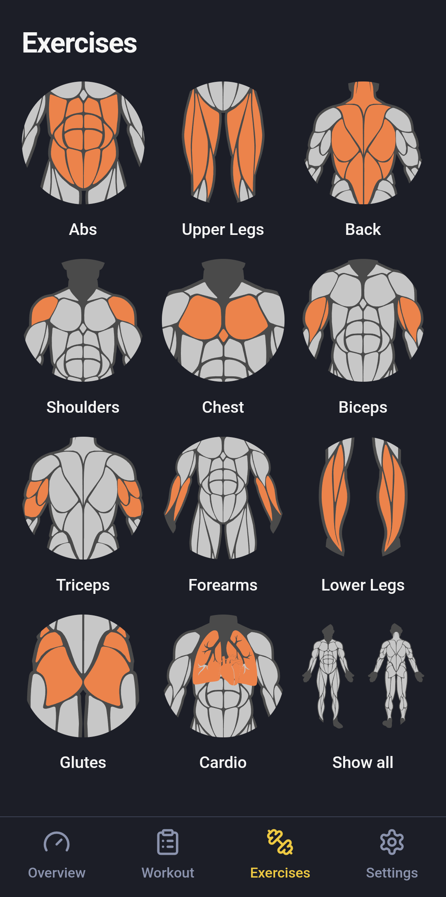 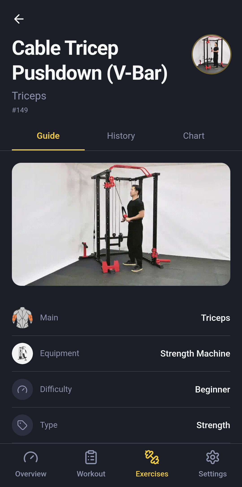

### Train: one exercise at a time, muscles lit up as you go

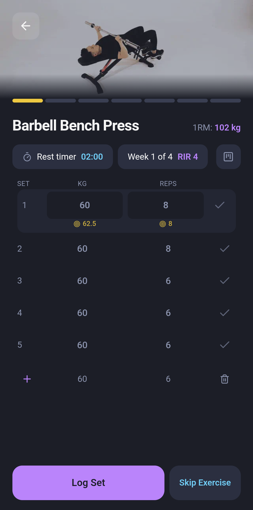 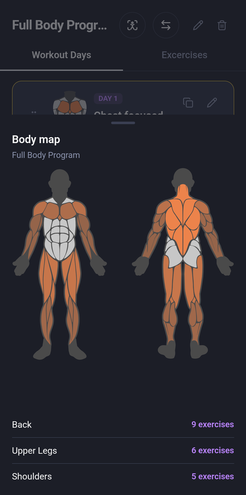

### Watch progress: best lifts, set history, time per week

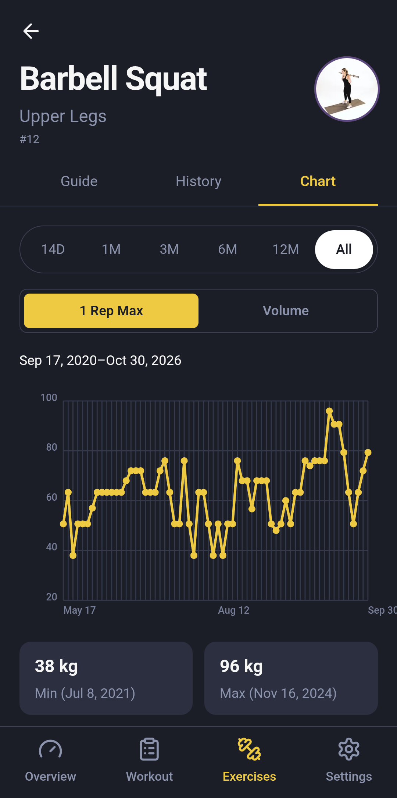 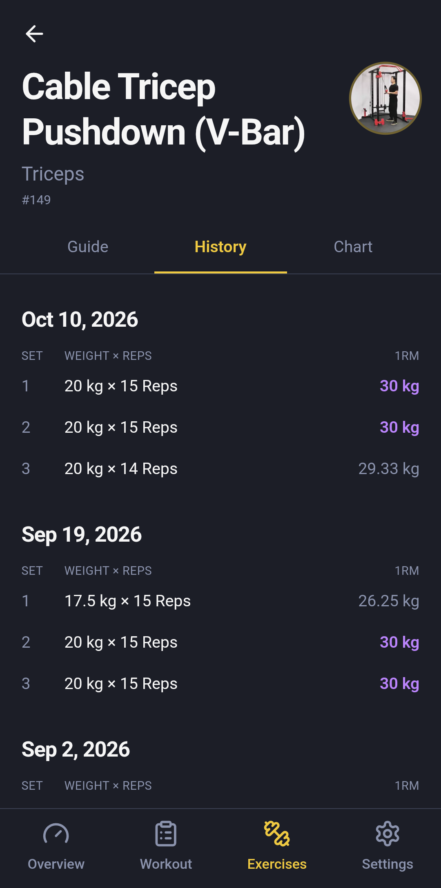 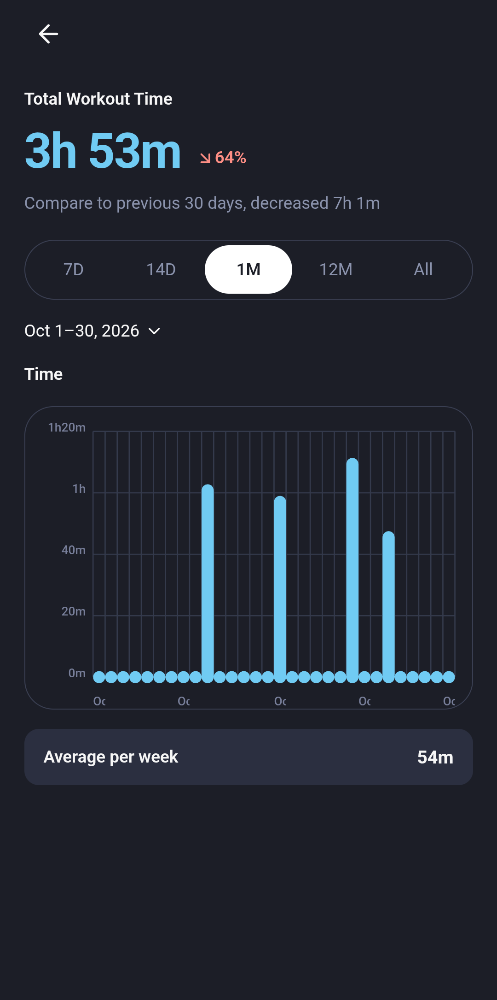

### Know your numbers: body stats and a daily calorie target

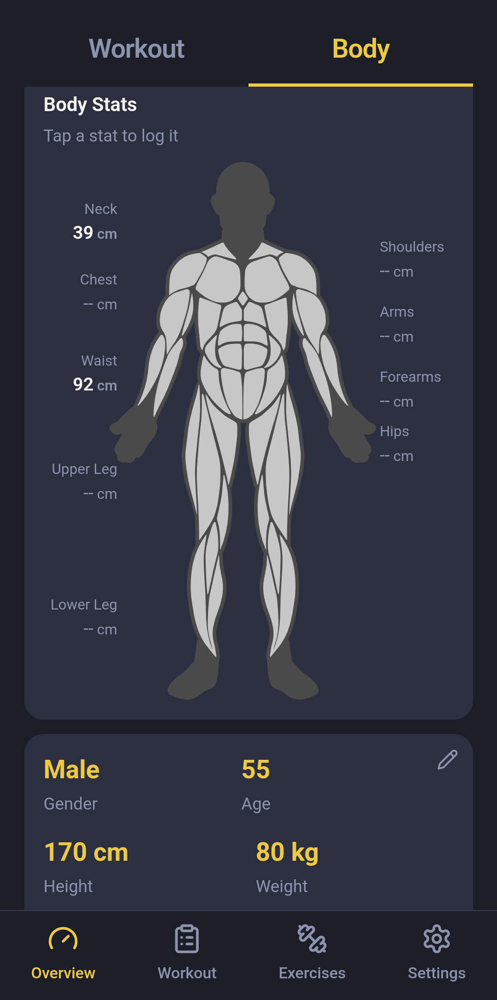 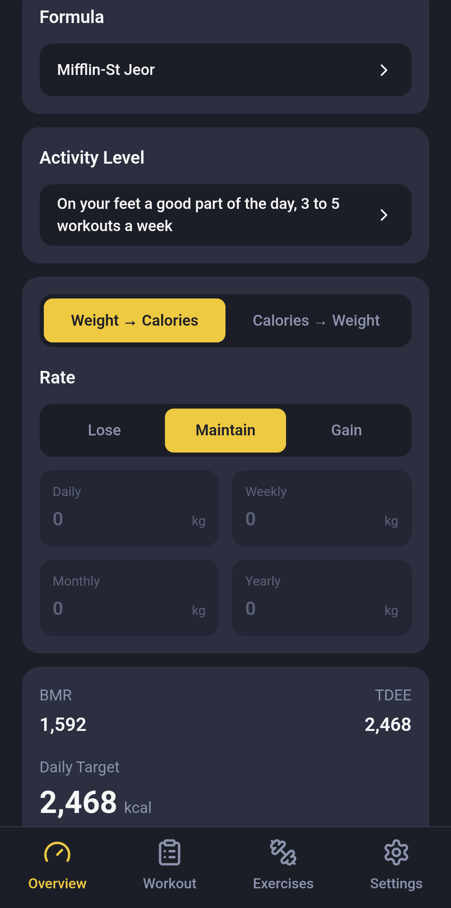

## Credit

Exercise names, descriptions and images belong to [JEFIT](https://www.jefit.com) and are mirrored here for personal training. LibreSteel is not affiliated with JEFIT.

## Building it

```sh
dx serve --no-default-features --features desktop   # desktop
dx build --android                                  # phone APK
```
